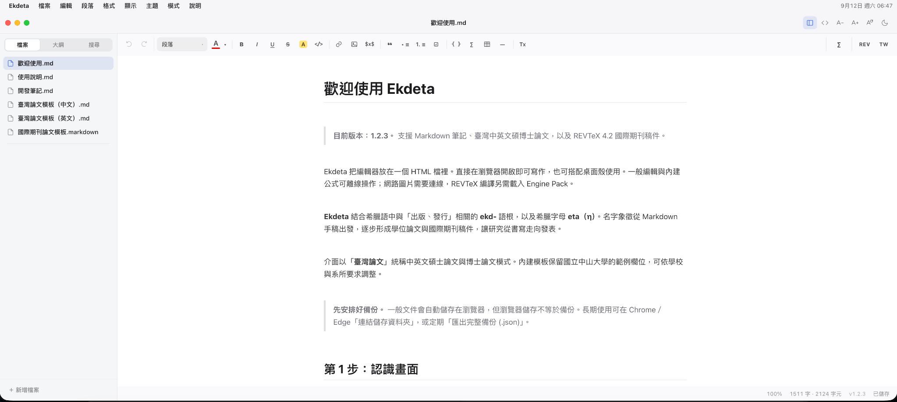
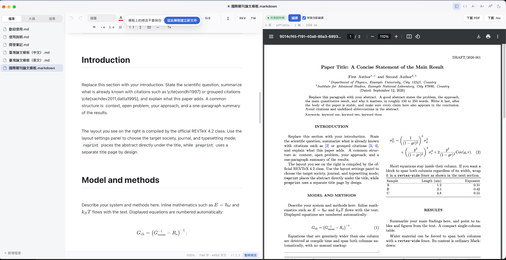

<p align="right">
  <strong>English</strong> · <a href="README.zh-TW.md">繁體中文</a>
</p>

<p align="center">
  
</p>

<h1 align="center">Ekdeta</h1>

<p align="center"><strong>Write in Markdown. Finish a thesis or a journal manuscript.</strong></p>

<p align="center">
  A single-file academic writing environment for Markdown, Taiwan thesis workflows, and REVTeX 4.2.<br>
  <strong>v1.2.3 · Browser + Electron desktop · Jason Chen</strong>
</p>

## Where the name “Ekdeta” comes from

**Ekdeta** combines **ekd-**, a Greek root associated with publishing and bringing written work to the public, with **eta (η)**, the Greek letter that lends the name a subtle scientific character. Together, they reflect Ekdeta’s purpose: turning a Markdown manuscript into a polished thesis or journal paper, and guiding research from writing to publication.

## Why I built it

Ekdeta started with a simple request from my lab advisor: could we write in Markdown and stop relearning a different typesetting workflow every time the final format changes?

That is still the main idea. You write the research once, in Markdown. When it is time to submit, Ekdeta changes the output workflow instead of forcing you to rewrite the manuscript in a different language.

| What you are writing | What you write | What Ekdeta can produce |
| --- | --- | --- |
| Notes, drafts, general documents | Markdown | Markdown / HTML workspace |
| Taiwan master's or doctoral thesis | Markdown + Taiwan Thesis mode | Searchable PDF |
| International journal manuscript | Markdown + REVTeX 4.2 | `.tex` + real TeX PDF + REVTeX project ZIP |

The goal is not to make Markdown *look* vaguely like a paper. Markdown remains the source manuscript, while the thesis and journal modes produce the files you actually need at the end.

## What it looks like

### The normal writing workspace



The left side holds files, search, and the document outline. The main area behaves like a Typora-style Markdown editor: you can stay in rendered view most of the time, switch to full source when you want it, and use the toolbar for tables, equations, thesis structure, and journal tools.

### REVTeX: Markdown on the left, the real compiled PDF on the right



This is the part that matters for journal work. The right side is not an HTML imitation of a paper. Once the TeX Engine Pack is loaded, Ekdeta runs the REVTeX / pdfLaTeX workflow and shows the resulting PDF. You can inspect two-column layout, equations, references, floats, and line breaks before exporting the submission files.

## Quick start

### The lightest way: open one HTML file

Download this file from the GitHub Release:

```text
Ekdeta-1.2.3.html
```

Open it in Chrome or Edge. That single file is the full Core, not a demo. You can immediately use Markdown, MathLive, images, tables, and the Taiwan thesis workflow without installing a desktop app.

For long projects, link a storage folder so your Markdown and images also live in a normal project directory. Export a Full Backup JSON at important milestones. Browser storage is convenient, but it should not be your only backup.

### Prefer a normal desktop app?

The repository also includes an Electron shell around the same Core.

- macOS maintainers can build `.dmg`, `.pkg`, and `.zip` packages.
- Windows x64 maintainers can build an NSIS installer.
- Windows users can also use the no-Node portable builder, which downloads a pinned Electron runtime and verifies its official SHA-256 before packaging Ekdeta.

See [Desktop builds](docs/DESKTOP.md). The GitHub Release also includes `Ekdeta-Electron-Desktop-1.2.3.zip` as a complete desktop build kit.

## Taiwan thesis workflow: Markdown to PDF

Ekdeta includes Traditional Chinese and English thesis templates, together with Digital and Print layouts. The manuscript stays in Markdown. Cover information, abstract, table of contents, figures, citations, references, appendices, and other thesis structures can be inserted through the thesis tools instead of being maintained as a second typesetting language.

A typical workflow is straightforward:

1. Create a working document from the Chinese or English thesis template.
2. Pick the Digital or Print layout that matches the submission format.
3. Write the body in Markdown.
4. Use the thesis tools for cover data, contents, citations, and front/back matter.
5. Export a vector/searchable PDF and review it page by page before submission.

Ekdeta handles the writing and layout workflow. Your university's current thesis rules remain the final authority, so check the exported PDF against the latest requirements before submitting it.

## International journals: Markdown to REVTeX, `.tex`, and PDF

Switch to **International Journal / REVTeX 4.2** when you need a journal manuscript. The editor stays Markdown-first. REVTeX-specific structures such as authors, affiliations, abstract, citations, equations, figures, wide content, and bibliography can be inserted with forms instead of hand-writing an entire TeX document.

The compile path is:

```text
Markdown manuscript
        ↓
REVTeX project
        ↓
BusyTeX / TeX Live Engine
        ↓
real TeX PDF
        ↓
PDF + main.tex + REVTeX project ZIP
```

That lets you keep the speed of Markdown while still leaving with normal LaTeX files for collaborators, submission systems, or a full TeX installation.

## REVTeX needs an Engine Pack

Ordinary Markdown, MathLive, and the Taiwan thesis PDF workflow do **not** require the large TeX Engine Pack.

You only need it when Ekdeta must actually compile REVTeX / LaTeX. Ekdeta 1.2.3 is locked to the BusyTeX 1.2.3 / TeX Live 2026 recommended assets and validates five files by size and SHA-256:

```text
busytex.js
busytex.wasm
busytex_pipeline.js
texlive-recommended.js
texlive-recommended.data
```

Official asset page:

- <https://github.com/TeXlyre/texlyre-busytex/releases/tag/assets-v1.2.3>

Download the v1.2.3 assets, extract them, and point Ekdeta at the directory that directly contains those five files. Do not mix files from different BusyTeX releases. The exact hashes and setup steps are in [REVTeX Engine Pack setup](docs/REVTeX-ENGINE.md).

If a manuscript needs a full XeLaTeX/CJK stack, special fonts, or journal-specific packages beyond the bundled engine profile, export the `.tex` or REVTeX project ZIP and finish the build in full TeX Live, MacTeX, MiKTeX, or the journal submission system.

## Writing features

Ekdeta keeps the editor useful even when you are not writing a thesis or paper:

- Typora-style local Markdown editing with a full-source mode when you need it.
- MathLive visual equation entry while storing standard LaTeX in the document.
- Document outline, cross-file search, Quick Open, tables, image paste/drag, and relative image paths.
- Linked-folder synchronization and Full Backup JSON for moving work between machines.
- Light and dark themes, focus/typewriter modes, and separate settings for writing and formal paper layouts.

## What is in this repository?

The product itself can be used as one file:

```text
Ekdeta.html
```

The repository also keeps the small amount of source and tooling needed to maintain that file responsibly:

```text
Ekdeta/
├── Ekdeta.html              # ready-to-use single-file Core
├── source/                  # deterministic Core source + tests
├── desktop/                 # Electron shell for macOS / Windows
├── assets/                  # app icon
├── docs/                    # screenshots and setup guides
├── third_party/             # third-party notices / source records
├── README.md                # English
└── README.zh-TW.md          # Traditional Chinese
```

The much larger development handoff archive is intentionally not reproduced here. Historical AI conversations, checkpoint evidence, old patches, research material, and intermediate validation artifacts are useful during development, but they are not part of the public product.

## Rebuilding the single-file Core

```bash
python3 source/build.py --output Ekdeta.html
```

For 1.2.3, the public source has been checked to rebuild the release `Ekdeta.html` byte-for-byte.

Core checks:

```bash
node source/tests/check_scripts.cjs source/src/scripts
node source/tests/behavior.mjs Ekdeta.html
node source/tests/semantic_checks.cjs source/src/scripts
node source/tests/ui_content_checks.cjs Ekdeta.html
python3 source/tests/audit_product.py Ekdeta.html --name Ekdeta --version 1.2.3
```

See [VALIDATION.md](VALIDATION.md) for the reproducibility notes.

## Author and license

Ekdeta 1.2.3 is developed by **Jason Chen**.

First-party source code and documentation are released under the MIT License. KaTeX, MathLive, REVTeX, Electron, fonts, and the external BusyTeX Engine Pack keep their own licenses. See [THIRD_PARTY_NOTICES.md](THIRD_PARTY_NOTICES.md) for details.
