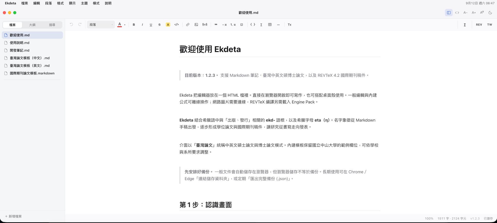
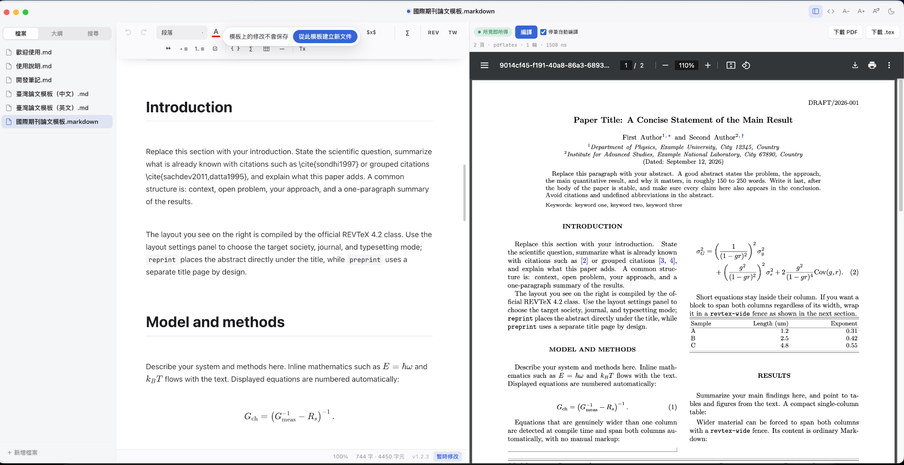

<p align="right">
  <a href="README.md">English</a> · <strong>繁體中文</strong>
</p>

<p align="center">
  
</p>

<h1 align="center">EKdelta</h1>

<p align="center"><strong>只要寫 Markdown，就能一路走到碩博士論文與國際期刊投稿。</strong></p>

<p align="center">
  一套把 Markdown、臺灣碩博士論文與 REVTeX 4.2 放在同一個寫作環境裡的工具。<br>
  <strong>v1.2.5 · 單檔 HTML + Electron 桌面版 · Jason Chen</strong>
</p>

<table align="center">
  <tr>
    <td align="center">
      <strong>「EKdelta」這個名字</strong><br><br>
      <strong>EKdelta</strong> 結合了希臘語中與「出版、發行」相關的 <strong>ekd-</strong> 語根，以及科學上代表「變化」的希臘字母 <strong>delta（δ）</strong>，描述從 Markdown 手稿走到學位論文與期刊稿件的過程。<br><br>
      <sub>1.2.2–1.2.3 版名為 Ekdeta，更早名為 Typora HTML，都是同一個程式。</sub>
    </td>
  </tr>
</table>

## 為什麼做 EKdelta

EKdelta 的起點其實很單純。實驗室教授希望我們把時間花在研究和寫作，而不是每換一種交件格式，就重新學一套排版語法。

所以我把「寫內容」和「最後要交什麼格式」拆開。平常只寫 Markdown；真的要送論文時，再切到對應的工作模式。正文不用重寫，也不用為了排版把同一份研究內容維護兩遍。

| 你現在要做的事 | 你實際寫什麼 | 最後可以拿到什麼 |
| --- | --- | --- |
| 研究筆記、草稿、一般文件 | Markdown | Markdown / HTML 工作內容 |
| 臺灣中英文碩博士論文 | Markdown + 臺灣論文模式 | 可搜尋 PDF |
| 國際期刊論文 | Markdown + REVTeX 4.2 | `.tex` + 真實 TeX PDF + REVTeX project ZIP |

EKdelta 不是把 Markdown「畫得像論文」而已。Markdown 是真正的來源稿件，臺灣論文與 REVTeX 模式負責把同一份內容帶到最後的正式輸出。

## 先看畫面

### 平常寫作就是 Markdown



左邊是文件、搜尋與大綱，中間是接近 Typora 的 Markdown 編輯區。大部分時間可以直接看排版後的內容；需要時再切完整原始碼。表格、公式、臺灣論文工具與 REVTeX 工具都在同一個工作環境裡。

### REVTeX：左邊寫 Markdown，右邊看真正編譯出的 PDF



這張圖最能說明 EKdelta 的期刊工作流。右邊不是 HTML 模擬出來的論文預覽；載入 TeX Engine Pack 之後，EKdelta 會跑真正的 REVTeX / pdfLaTeX 編譯流程。雙欄、公式、引用、浮動物件和最後的換行，可以在投稿前直接看實際結果。停筆後右邊會自動重新編譯；內容還沒打完或編譯失敗時，右邊保留上一份正確的 PDF，只用一行字提示，改好就自動恢復。

## 最快開始的方法

### 不想安裝東西：直接開一個 HTML

從 GitHub Release 下載：

```text
EKdelta-1.2.5.html
```

用 Chrome 或 Edge 開啟即可。這個 HTML 就是完整 Core，不是 demo。一般 Markdown、MathLive、圖片、表格和臺灣論文流程都能直接使用。

如果是長期專案，建議再使用「連結儲存資料夾」，讓 `.md` 和圖片同步到真正的專案目錄。重要階段另外匯出 Full Backup JSON。瀏覽器儲存很方便，但不要把它當成唯一備份。

### 想要一般 App 的使用感：Electron 桌面版

Repository 裡的 `desktop/` 是同一份 EKdelta Core 的 Electron 外殼，不是另一套編輯器。

- macOS 維護者可以建出 `.dmg`、`.pkg`、`.zip`。
- Windows x64 可以建 NSIS 安裝版。
- Windows 還有一條免 Node.js 的 portable 建置流程：下載固定 Electron runtime，先驗證官方 SHA-256，再把 EKdelta 打成可攜版。

完整步驟見 [`docs/DESKTOP.zh-TW.md`](docs/DESKTOP.zh-TW.md)。GitHub Release 也會附上 `EKdelta-Electron-Desktop-1.2.5.zip` 桌面建置包。這一版的桌面 App 名稱仍是 EKdelta：App 名稱決定設定與引擎的存放位置，改名要搭配實機打包測試。

## 臺灣碩博士論文：Markdown → PDF

EKdelta 內建中英文臺灣論文模板，也有 Digital / Print 版面。正文仍然用 Markdown 寫；封面、摘要、目錄、圖表、引用、參考文獻、附錄等結構，則可以透過臺灣論文工具處理，不需要另外維護一份排版語法。

最短流程就是：

1. 從中文或英文論文模板建立自己的工作文件。
2. 選擇符合交件需求的 Digital / Print 版面。
3. 正文照平常方式用 Markdown 寫。
4. 用論文工具補封面、目錄、引用與前後置內容。
5. 匯出向量／可搜尋 PDF，最後逐頁檢查。

EKdelta 可以把寫作到 PDF 的流程接起來，但不會替學校規章做決定。正式送件前，還是要用當年度的校方格式要求檢查最後 PDF。

## 國際期刊：Markdown → REVTeX 4.2 → `.tex` + PDF

切到 **International Journal / REVTeX 4.2** 後，左邊仍然是 Markdown。作者、affiliation、abstract、citation、equation、figure、wide content、bibliography 等 REVTeX 結構，可以用表單插入，不必把整篇論文改寫成手打 TeX。

真正編譯時會走：

```text
Markdown manuscript
        ↓
REVTeX project
        ↓
BusyTeX / TeX Live Engine
        ↓
real TeX PDF
        ↓
PDF + main.tex + REVTeX project ZIP
```

這樣平常保留 Markdown 的寫作速度，投稿時又能拿到標準 LaTeX 檔案，交給共同作者、投稿系統或完整 TeX 環境繼續處理。

## REVTeX 為什麼還要 Engine Pack？

一般 Markdown、MathLive、臺灣論文 PDF 都**不需要**大型 TeX Engine Pack。

只有真的要讓 EKdelta 執行 REVTeX / LaTeX 編譯時才需要。EKdelta 1.2.5 使用 BusyTeX 1.2.3 / TeX Live 2026 recommended，會驗證下面五個檔案的大小與 SHA-256：

```text
busytex.js
busytex.wasm
busytex_pipeline.js
texlive-recommended.js
texlive-recommended.data
```

官方下載頁：

- <https://github.com/TeXlyre/texlyre-busytex/releases/tag/assets-v1.2.3>

下載 v1.2.3 assets、解壓後，讓 EKdelta 指向能直接看到上述五個檔案的資料夾。不要把不同 BusyTeX release 的檔案混在一起。精確 hash 與載入步驟請看 [`docs/REVTeX-ENGINE.zh-TW.md`](docs/REVTeX-ENGINE.zh-TW.md)。

如果稿件需要完整 XeLaTeX/CJK、特殊中文字型或期刊額外套件，建議從 EKdelta 匯出 `.tex` 或 REVTeX project ZIP，再交給完整 TeX Live、MacTeX、MiKTeX 或投稿系統編譯。

## 平常寫作也用得到的功能

- Typora-style Markdown：平常看排版結果，需要時再編輯區塊原始碼。
- Full Source Mode：想直接處理完整 Markdown 時可以切換。
- MathLive 視覺公式：不用先背完 LaTeX 才能輸入分數、積分、矩陣；文件裡保存的仍是標準 LaTeX。
- 文件大綱、跨文件搜尋、Quick Open、表格、圖片拖放與相對路徑。
- 資料夾同步和 Full Backup JSON，方便長期保存或跨電腦搬移。
- 明暗主題、Focus / Typewriter 模式，以及一般寫作與正式論文分開的設定。

## 這個 GitHub repository 放什麼？

真正可以直接用的產品其實只有：

```text
EKdelta.html
```

不過如果 GitHub 只留一個 5 MB 左右的 HTML，未來會很難維護。所以公開 repo 同時保留「可以確定重建同一產品」需要的精簡 source，以及真正有用的 Desktop / 文件：

```text
EKdelta/
├── EKdelta.html              # 可直接使用的單檔 Core
├── source/                  # deterministic Core source + tests
├── desktop/                 # Electron macOS / Windows 外殼
├── assets/                  # App icon
├── docs/                    # 截圖與安裝說明
├── third_party/             # 第三方授權 / 來源紀錄
├── README.md                # English
└── README.zh-TW.md          # 繁體中文
```

原始交接包裡的大量 AI 對話、checkpoint 證據、舊 patch、研究素材與中間驗證產物不會原封不動放進公開 repo。那些資料對續接開發有用，但不是一般使用者需要下載的產品內容。

## 從公開 source 重建 EKdelta.html

```bash
python3 source/build.py --output EKdelta.html
```

目前 1.2.5 的公開 source 已經驗證，可以重建出和正式交接產品逐位元組相同的 `EKdelta.html`。

核心驗證：

```bash
node source/tests/behavior.mjs EKdelta.html
node source/tests/semantic_checks.cjs source/src/scripts
node source/tests/ui_content_checks.cjs EKdelta.html
python3 source/tests/audit_product.py EKdelta.html --name EKdelta --version 1.2.5
```

更多重現資訊見 [`VALIDATION.md`](VALIDATION.md)。

## 作者與授權

EKdelta 1.2.5 由 **Jason Chen** 開發。

第一方原始碼與文件採 MIT License。KaTeX、MathLive、PDF.js、REVTeX、Electron、字型與外部 BusyTeX Engine Pack 依各自授權。詳細資訊見 [`THIRD_PARTY_NOTICES.md`](THIRD_PARTY_NOTICES.md)。
